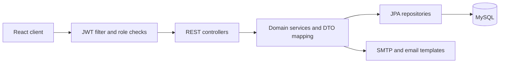

# FieldGuardian · Backend

A Java/Spring Boot API for managing fields, crops, staff, vehicles, equipment, and monitoring logs. This individual crop-management project models the Green Shadow farm scenario; the scenario should not be read as a claim of a commercial client deployment.

[Case study](https://www.grbulegoda.com/work/fieldguardian) · [Frontend](https://github.com/gayanukabulegoda/FieldGuardian-FRONTEND) · [API documentation](https://documenter.getpostman.com/view/36681432/2sAYBaBAHq)

## What it demonstrates

- Related farm records, staff assignments, and operational monitoring.
- Multipart uploads for field, crop, and monitoring-log records.
- JWT authentication and method-level permissions for manager, administrative, and scientist roles.
- Staff-based registration with email OTP verification.
- Dashboard counts and field summaries.

**Stack:** Java 21, Spring Boot 3.3.5, Spring Security, Spring Data JPA/Hibernate, MySQL, Maven, and Thymeleaf email templates.

## Architecture



Java sources are under `src/main/java/lk/ijse/fieldguardianbackend/`.

| Directory | Responsibility |
| --- | --- |
| [controller](src/main/java/lk/ijse/fieldguardianbackend/controller) | REST endpoints and method-level access rules |
| [service/impl](src/main/java/lk/ijse/fieldguardianbackend/service/impl) | Domain operations, authentication, dashboard queries |
| [repository](src/main/java/lk/ijse/fieldguardianbackend/repository) | Database queries |
| [entity](src/main/java/lk/ijse/fieldguardianbackend/entity) / [dto](src/main/java/lk/ijse/fieldguardianbackend/dto) | Persistence models and request/response objects |
| [config](src/main/java/lk/ijse/fieldguardianbackend/config) | Security and CORS configuration |
| [resources](src/main/resources) | Application profiles, email templates, and logging configuration |

## Run locally

You need JDK 21, MySQL, and an SMTP account or local mail service for OTP flows. The Maven wrapper is included. Use a dedicated development database.

### 1. Clone

```sh
git clone https://github.com/gayanukabulegoda/FieldGuardian-BACKEND.git
cd FieldGuardian-BACKEND
```

### 2. Supply local configuration

The default profile is `dev`. Its database, mail, JWT, and CORS values need configuration. Set these environment variables in your IDE run configuration or terminal; replace the examples with local values:

| Variable | Example / purpose |
| --- | --- |
| `SPRING_PROFILES_ACTIVE` | `dev` |
| `SERVER_PORT` | `5055` |
| `DB_URL` | `jdbc:mysql://localhost:3306/fieldguardian` |
| `DB_USERNAME` | Your development database user |
| `DB_PASSWORD` | Your development database password |
| `MAIL_USERNAME` | SMTP username |
| `MAIL_PASSWORD` | SMTP password or app password |
| `JWT_SECRET` | A Base64-encoded random secret of at least 32 bytes |
| `CORS_ALLOWED_ORIGINS` | The frontend origin, for example `http://localhost:5173` |

Generate a local JWT secret with `openssl rand -base64 32`. Keep its output private. Environment variables override the checked-in profile values; Spring Boot does not automatically load a `.env` file.

The common configuration uses Gmail SMTP on port 587 with authentication and STARTTLS. For another provider, override `SPRING_MAIL_HOST`, `SPRING_MAIL_PORT`, and the relevant SMTP properties. For a local mail catcher, also adjust authentication/TLS to match that service.

Create the MySQL database before startup. Hibernate's development `ddl-auto=update` creates/updates tables; it is not a versioned production migration strategy.

### 3. Start

macOS/Linux:

```sh
sh mvnw spring-boot:run
```

Windows PowerShell:

```powershell
.\mvnw.cmd spring-boot:run
```

With the example port, the API base is:

```text
http://localhost:5055/fieldGuardian/api/v1
```

The `/fieldGuardian` context path is required. Browser requests must use the configured frontend origin.

### 4. Prepare an authorized account

Registration requires an existing, non-removed staff record whose designation maps to `MANAGER`, `ADMINISTRATIVE`, or `SCIENTIST`. It also requires a valid email OTP. The repository does not supply a seed script or default administrator credentials, so a fresh database needs suitable development seed data before this flow can succeed.

Once staff data and SMTP are configured:

1. Request an OTP through `POST /auth/otp?option=0&email=...`.
2. Register through `POST /auth/register` with `email`, `password`, and `otp`.
3. Sign in through `POST /auth/authenticate` with `email` and `password`.
4. Use the returned token as `Authorization: Bearer <token>` on protected requests.

Use the frontend or linked Postman documentation to exercise the flows. Seed only fictional development data.

## API map

Paths below are relative to `/fieldGuardian/api/v1`.

| Area | Route prefix | Purpose |
| --- | --- | --- |
| Authentication | `/auth` | OTP, registration, sign-in, token validation/refresh |
| Accounts | `/user` | User reads, updates, removal |
| Farm records | `/field`, `/crop` | Fields, crops, and relationships |
| Resources | `/staff`, `/vehicle`, `/equipment` | Personnel and equipment assignments |
| Monitoring | `/monitoring-log` | Observations, images, linked crops and staff |
| Dashboard | `/dashboard` | Counts and top-field summaries |
| Health view | `/health-test` | HTML health view; authentication is required by the current security configuration |

Write operations have role restrictions. See controller annotations for the exact rules and payload formats.

## Validation and limitations

- `sh mvnw test` runs the included Spring context test; it needs the database and application configuration. There is no comprehensive endpoint test suite.
- `sh mvnw package` builds the application and runs tests. On Windows, use `.\mvnw.cmd` in place of `sh mvnw`.
- Initial staff provisioning and versioned database migrations are not automated.
- OTP storage is in memory. Restarting the service clears pending OTPs.
- Treat this as a development project. Review authentication, authorization, deployment settings, and dependencies before exposing it publicly.

## License and author

[MIT](LICENSE) · [Gayanuka Bulegoda](https://www.grbulegoda.com)
